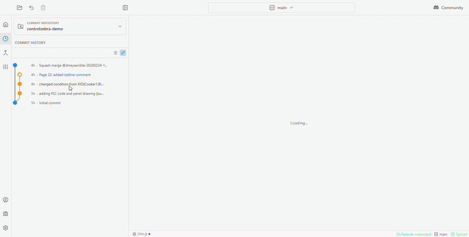

# IOFabrik

IOFabrik is a desktop Git client for industrial automation teams. Track PLC and HMI projects, compare revisions, and share changes without using the command line.

The demo was recorded before the IOFabrik rename and shows the previous branding.

## What you can do

- Save project revisions and browse previous versions.
- Compare ladder logic (`.l5x`), electrical drawing PDFs, images, and text files.
- Review and resolve conflicting changes with a guided workflow.
- Work locally, or connect to GitHub to share and sync with your team.

IOFabrik manages project revisions; keep using your engineering software to edit PLC and HMI projects. Visual comparisons are available for supported file formats, not every project file.

## Download

See the [installation guide](docs/onboarding/Installation.md). Get the Windows installer from [IOFabrik releases](https://github.com/IOFabrik/IOFabrik-CE/releases/latest).

This repository contains the source code. You do not need to build it to use the desktop app.

## First steps

1. Open your project folder in IOFabrik.
2. Follow the guidance in Home to start tracking the project.
3. Make edits in your engineering software, then return to IOFabrik to review and **Save Changes**.
4. Connect to GitHub when you want to share and sync your work.

## Help and feedback

- [Documentation](docs/HOME.md)
- [Report a bug or request a feature](https://github.com/IOFabrik/IOFabrik-CE/issues) — include your app version, operating system, and steps to reproduce. Remove confidential project data from screenshots and attachments.
- [Report a security vulnerability privately](SECURITY.md).

## Build and contribute

Read the [contribution guide](CONTRIBUTING.md) for licensing requirements and how to submit changes. Follow the [development setup](docs/onboarding/Development%20Setup.md) for prerequisites and build instructions.

Source builds install the `ladder-visualizer` library from the immutable Git commit pinned in the frontend package files. See the development setup for the standard install and the optional local-library workflow.

## License

The public edition is licensed under the [GNU Affero General Public License v3.0](License.md). For alternative commercial licensing inquiries, contact [hello@iofabrik.com](mailto:hello@iofabrik.com).
